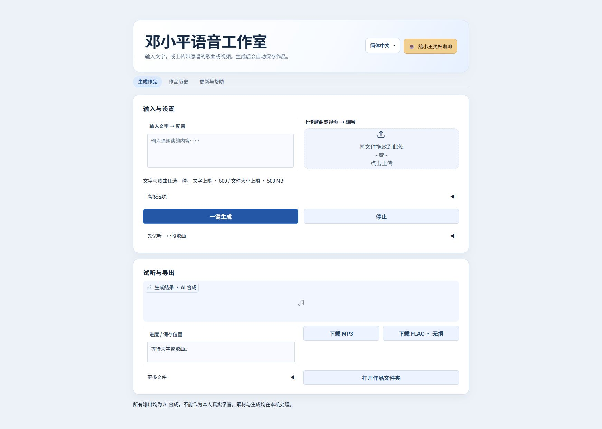

# 邓小平语音工作室

蓝白版式，文字与歌曲入口并排，播放器和导出集中在下方。 右上角语言菜单列出全球使用人数最多的 20 种语言，普通话可选简体或繁体。切换语言会保留草稿。

[下载 Windows 安装包](https://github.com/2009Wu/deng-xiaoping-voice/releases/latest/download/Deng-Xiaoping-Voice-Studio-Windows.zip) · [Hugging Face 项目页](https://huggingface.co/spaces/Little-Wang/deng-xiaoping-voice)

当前 Windows 版 **v0.2.8**。[版本说明](docs/releases/v0.2.7.md)

安装更新后，缺少的桌面快捷方式会自动补建。已有快捷方式会沿用，图标变更时会更新原图标。

双击桌面图标进入工作室。安装界面在工作室打开后会自动收起，关闭工作室会结束后台服务。

启动时自动检查更新。有新版时，右下角会提醒，版本下方也会显示更新内容。在「更新与帮助」的版本下方或右下角提醒里，点击「安装更新并重启」即可完成升级。

Windows 10 / 11，NVIDIA 显卡，建议至少 6 GB 显存。首次安装预留 30 GB 空间。

1. 完整解压安装包，双击 Start Deng Voice Studio.exe。
2. 首次点击“安装并打开工作室”。依赖和模型下载完成后，工作室窗口会自动打开。
3. 输入文字或上传有原唱的音频／视频，点击“一键生成”。也可先试听一小段歌曲。
4. 生成结果自动保存到“文档 / Voice Studio作品 / 邓小平语音工作室”。

固定音色参考来自 1974 年联合国大会讲话。所有生成结果均为 AI 合成。

代码采用 GPL-3.0。参考音频和图标分别见 [来源说明](THIRD_PARTY_NOTICES.md)。本机已验证启动、输出界面和安装包解压，实际生成效果尚待试听。

Windows 启动器会自动从 FLAC 恢复参考 WAV。直接运行源码前可执行 `python windows/restore_references.py`。

[给小王买杯咖啡](https://ko-fi.com/little_wang)

## 提交反馈

欢迎分享功能建议、程序问题，以及配音或翻唱质量上的意见。[打开反馈表单](https://github.com/2009Wu/custom-voice-studio/issues/new?template=studio-feedback.yml)（需登录 GitHub，内容公开）。

## 可选的匿名使用统计

首次安装不会启用统计。愿意帮助改进时，可通过安装文件夹中的
`Analytics Preferences.cmd` 自行选择开启或关闭。统计包括生成次数、
首次导出格式、A/B 采用情况和粗略生成参数。若另外开启公开歌曲统计，只发送
已登记的公开歌曲编号。音频、文件名、输入文字、参考人声、账号和设备编号
不会发送。后台数据保留 90 天。

## 本次更新 · v0.2.8

修复 FFmpeg 下载地址失效导致首次安装卡在 12% 的问题。下载失败时会显示依赖及 HTTP 状态，已校验文件可复用。

## 本次更新 · v0.2.7 · 上一版

- 双击桌面图标后先显示工作室窗口，同时加载本地服务与界面。
- 完整翻唱可用已保存的人声、伴奏重新混音。调完音量可试听约 12 秒，再将整首另存到作品历史。
- 可选的公开歌曲统计在本机识别已登记录音。同一录音换成 MP3 或 MP4 仍可匹配，统计只发送曲目编号。
